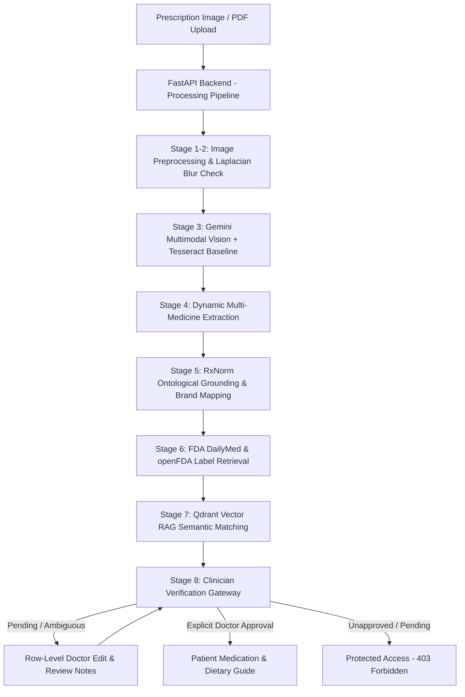

# Generative AI-Based Medical Document Analysis and Information Retrieval System

> **MedDRAG: An Evidence-Grounded Multimodal RAG Clinical Decision Support Platform**  
> Reads handwritten medical prescriptions, extracts all prescribed medications, verifies drug names via official NIH/NLM RxNorm, retrieves dietary and drug warnings from FDA DailyMed labels via vector search, and enforces a mandatory clinician verification gateway before releasing patient-facing guides.

---

## 1. Project Overview & Clinical Context

Handwritten medical prescriptions remain one of the primary vectors for outpatient medication errors worldwide. Illegible physician handwriting, dense medical Latin abbreviations (`OD`, `BD`, `TDS`, `pc`, `1-0-1`), and absent dietary interaction warnings harm over 1.5 million patients annually (WHO & Institute of Medicine data). Furthermore, over 50% of patients unknowingly consume foods that interfere with drug bioavailability (e.g., dairy binding to fluoroquinolones, or grapefruit juice inhibiting CYP3A4 metabolism of statins), while fewer than 16% ever receive dietary counseling during outpatient consultations.

**MedDRAG** addresses these challenges through a constrained, evidence-grounded **Multimodal RAG architecture**:

1. **Multimodal Vision Understanding:** Reads raw handwritten prescription images and multi-page PDFs directly, dynamically extracting **all** prescribed medications without omissions.
2. **Ontological Grounding (RxNorm):** Matches extracted drug names to official NIH/NLM concept identifiers (RxCUIs) and standardizes trade names (including regional Indian brand mappings like Dolo 650, Augmentin, and Pantocid).
3. **Official Drug-Food Interaction RAG:** Retrieves authoritative evidence strictly from official U.S. FDA DailyMed Structured Product Labels (SPL) and openFDA drug label endpoints, indexed in an embedded **Qdrant vector database**.
4. **Physician Verification Triage Gateway:** Displays the original prescription image alongside extracted information for rapid doctor review, row-level validation, and sign-off (targeting &lt; 60 seconds).
5. **Verified Patient Summary:** Accessible **strictly after clinician approval** (protected by HTTP 403 access control), presenting a color-coded dietary guide (Avoid, Limit/Space by 2h, Safe) and structured dosage schedule.

---

## 2. Architecture & Processing Flow

### System Architecture Diagram



### 8-Stage Clinical Pipeline

1. **Prescription Uploaded:** SHA-256 checksum computation, file format validation (JPEG, PNG, PDF), size check (&le; 15 MB).
2. **Image Quality Checked:** Computes Laplacian variance for sharpness detection, contrast standard deviation, and pixel resolution.
3. **Handwriting Analyzed:** Runs Tesseract OCR baseline alongside Gemini Multimodal Vision for comparative transcription.
4. **Medicine Details Extracted:** Dynamically extracts every medication line on the prescription with name, strength, dosage, route, frequency, duration, and timing instructions.
5. **Drug Names Verified:** Grounded against NLM RxNorm REST API and the regional brand formulary.
6. **Official Drug Labels Retrieved:** Queries NLM DailyMed REST API and openFDA drug label endpoints.
7. **Evidence Assembled:** Performs Qdrant vector similarity search over drug interaction passages.
8. **Doctor Review Required:** Holds report in `pending_review` until physician review.

---

## 3. Technology Stack

### Frontend
- **Framework:** Next.js 16 (App Router)
- **Language:** TypeScript with strict type checking
- **Styling:** Tailwind CSS (Warm paper editorial clinical palette: `#F7F6F2`, `#202722`, `#315C4C`, `#E8EEE8`, `#E5E3DC`, `#A56A19`, `#A33F38`)
- **Typography:** Instrument Sans (interface text) and IBM Plex Mono (technical identifiers, RxCUIs, timestamps)
- **Icons:** Lucide React

### Backend
- **Framework:** Python 3.11+ / FastAPI
- **Database:** SQLAlchemy 2.0 with SQLite (`meddrag.db`), configurable for PostgreSQL
- **Validation:** Pydantic v2
- **Image Preprocessing:** OpenCV Headless (`cv2`) and Pillow (`PIL`)
- **External APIs:** HTTPX (async client) for RxNorm, DailyMed, openFDA
- **AI & RAG:** Official Google GenAI SDK (`google-genai`), Qdrant Vector Client (`qdrant-client` with embedded disk storage)
- **Testing:** Pytest, pytest-asyncio

---

## 4. Installation & Setup (Windows 11)

### Prerequisites
- Python 3.11, 3.12, 3.13, or 3.14 (Verified on Python 3.14)
- Node.js v18+ (Verified on Node.js v26.3.1 with npm 11.16.0)
- Git for Windows

### Step 1: Clone Repository
```powershell
git clone <repository_url> meddraggg
cd meddraggg
```

### Step 2: Backend Setup
```powershell
# Create Python virtual environment
python -m venv backend\venv

# Activate virtual environment
.\backend\venv\Scripts\activate

# Install backend dependencies
pip install -r backend\requirements.txt
```

### Step 3: Frontend Setup
```powershell
cd frontend
npm install
cd ..
```

### Step 4: Environment Configuration & Gemini API Key
Copy the template configuration file:
```powershell
copy .env.example .env
```

Configure your Gemini API key in `.env`:
```env
APP_MODE=live
GEMINI_API_KEY=your_gemini_api_key_here
GEMINI_MODEL=gemini-3.1-flash-lite
```

> **Tip:** You can also enter and activate your Gemini API key directly from within the web interface at **Settings (`/settings`)** or when uploading a prescription on **New Analysis (`/new-analysis`)**. The key is securely saved to your local `.env` and activated immediately without restarting the server.

---

## 5. How to Run the Application

### Option A: One-Click Startup (Recommended)
Double-click `run_all.bat` or execute in PowerShell:
```powershell
.\run_all.bat
```
This opens two independent console windows:
- **FastAPI Backend:** `http://localhost:8000` (Interactive API Docs at `http://localhost:8000/docs`)
- **Next.js Web Frontend:** `http://localhost:3000`

### Option B: Manual Startup
**Terminal 1 (Backend):**
```powershell
.\backend\venv\Scripts\activate
cd backend
python -m uvicorn app.main:app --host 127.0.0.1 --port 8000 --reload
```

**Terminal 2 (Frontend):**
```powershell
cd frontend
npm run dev
```

Open your browser at **[http://localhost:3000](http://localhost:3000)**.

---

## 6. How to Use & Workflow Guide

1. **Launch New Analysis (`/new-analysis`):**
   - Drag and drop or browse any prescription file (JPEG, PNG, or PDF).
   - If your Gemini API Key is not yet set, an inline activation card appears directly on the page—paste your key to activate it instantly.
   - Click **Analyze Prescription**.
   - Watch the live 8-stage pipeline execute: image quality check, Gemini multimodal vision transcription, dynamic extraction of all medications, NIH RxNorm CUI grounding, DailyMed SPL retrieval, and Qdrant semantic matching.

2. **Clinician Workspace (`/analysis/{id}`):**
   - Side-by-side verification: view the high-resolution prescription with pan/zoom controls beside the extracted medications table.
   - Every medication line from the prescription is listed with its confidence score, extracted raw text, normalized generic name, and RxCUI code.
   - Review or edit any field inline (name, strength, frequency, food timing).
   - Switch to the **Food & Drug Evidence** tab to inspect authoritative FDA DailyMed quotes, dietary precautions, and food-spacing recommendations.

3. **Safety Gate Verification:**
   - Attempting to access `/analysis/{id}/patient-summary` prior to physician verification triggers a strict **403 Forbidden** security barrier.

4. **Doctor Sign-Off & Approval:**
   - Under the **Doctor Review** tab, add clinician review notes and click **Approve & Unlock Patient Summary**.

5. **Patient Medication & Diet Guide (`/patient-summary`):**
   - Access the verified, patient-friendly report showing:
     - Clear daily dosing schedule (Morning, Afternoon, Evening, Bedtime).
     - Color-coded food interactions: **Avoid** (red), **Space by 2h** (amber), and **Safe** (emerald).
     - Print-ready clinical handout formatted for patients.

---

## 7. Running Automated Tests

Run the full pytest suite (Unit, Integration, and Flow tests):
```powershell
.\backend\venv\Scripts\pytest backend\tests -v
```

### Test Suite Execution
```
backend/tests/test_analyses_flow.py::test_create_and_process_scenario_1 PASSED
backend/tests/test_analyses_flow.py::test_scenario_2_ambiguity_blocks_approval_until_corrected PASSED
backend/tests/test_analyses_flow.py::test_dashboard_metrics PASSED
backend/tests/test_e2e_demo_workflow.py::test_full_demo_workflow PASSED
backend/tests/test_health.py::test_health_endpoints PASSED
backend/tests/test_health.py::test_demo_scenarios_list PASSED
backend/tests/test_rxnorm.py::test_regional_indian_brand_mapping PASSED
backend/tests/test_rxnorm.py::test_unmatched_drug_returns_no_verified_match PASSED

======================== 8 passed in 39.66s ========================
```

---

## 8. Ethical Clearance & Privacy Safeguards

- **Patient De-identification:** Uploaded prescription documents are stored locally in the secure data directory (`backend/data/uploads/`) and processed without third-party data tracking.
- **Official Medical Sources:** All drug identifications are verified against the National Library of Medicine (NLM) RxNorm API. All food-drug interaction warnings are extracted strictly from FDA-approved Structured Product Labels (DailyMed) and openFDA.
- **Safety Gate Protocol:** Unverified AI extractions are never shown directly to patients without explicit physician sign-off.
- **Clinical Disclaimer:** MedDRAG is a computer science decision-support prototype and does not replace the professional judgment of a licensed healthcare provider.

---

## 9. Project Directory Structure

```
meddraggg/
├── backend/
│   ├── app/
│   │   ├── main.py                  # FastAPI application entrypoint
│   │   ├── core/config.py           # Pydantic settings & environment configuration
│   │   ├── db/session.py            # SQLAlchemy database engine & sessionmaker
│   │   ├── models/entities.py       # Analysis, ExtractedMedicine, Evidence, Review, Audit
│   │   ├── schemas/schemas.py       # Pydantic request/response schemas
│   │   ├── services/
│   │   │   ├── image_processor.py   # OpenCV Laplacian blur & contrast check, OCR baseline
│   │   │   ├── pipeline_orchestrator.py # 8-stage state machine executor
│   │   │   ├── vision/gemini_vision.py # Google GenAI SDK multimodal vision integration
│   │   │   ├── rxnorm/rxnorm_client.py # NIH RxNorm REST API & Indian brand mapper
│   │   │   ├── dailymed/dailymed_client.py # FDA DailyMed SPL retrieval
│   │   │   ├── openfda/openfda_client.py # openFDA drug label retrieval
│   │   │   └── retrieval/qdrant_rag.py # Qdrant vector store & semantic passage matching
│   │   └── api/v1/                  # REST endpoints: analyses, medicines, evidence, review, metrics, settings, health
│   ├── data/                        # SQLite DB, uploads, and local vector storage
│   ├── tests/                       # Pytest test suite (health, analyses, rxnorm, e2e workflow)
│   └── requirements.txt             # Frozen Python dependencies
├── frontend/
│   ├── app/
│   │   ├── layout.tsx               # Root layout with fonts & sidebar
│   │   ├── page.tsx                 # Overview Dashboard
│   │   ├── new-analysis/page.tsx    # Upload & Real-Time Pipeline Tracker
│   │   ├── analysis/[id]/page.tsx   # Prescription Workspace & Doctor Review
│   │   ├── analysis/[id]/patient-summary/page.tsx # Approved Patient Summary (403 Gated)
│   │   ├── history/page.tsx         # Prescription History
│   │   ├── evidence-library/page.tsx # Evidence Library & FDA Search
│   │   ├── doctor-review/page.tsx   # Doctor Triage Queue
│   │   ├── settings/page.tsx        # Settings & Gemini API Key Management
│   │   └── globals.css              # Warm paper clinical styling
│   ├── components/Sidebar.tsx       # Compact clinical navigation sidebar
│   ├── lib/api.ts                   # Complete TypeScript API client
│   └── package.json                 # Next.js 16 dependencies
├── infra/
│   └── docker-compose.yml           # Optional Qdrant container configuration
├── run_all.bat                      # One-click startup script (Windows)
├── run_backend.bat                  # Backend launch script
├── run_frontend.bat                 # Frontend launch script
├── .env.example                     # Environment template
├── .gitignore                       # Git ignore specifications
└── README.md                        # Complete project documentation
```
