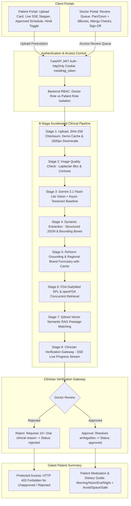

# MedDRAG: Evidence-Grounded Multimodal RAG Clinical Decision Support Platform

> **MedDRAG** is a dual-role (Doctor + Patient) clinical decision support platform designed to eliminate outpatient medication errors arising from illegible handwritten prescriptions. It combines Gemini Multimodal Vision with NIH RxNorm concept grounding, FDA DailyMed Structured Product Labels (SPL), Qdrant vector retrieval, and a mandatory clinician verification gateway before releasing patient-facing guides.

---

## 1. Clinical Context & Evidence Rationale

Handwritten outpatient prescriptions remain a pervasive clinical vulnerability across healthcare systems:

1. **Prescription Ambiguity & Illegibility:** The Institute of Medicine (IOM) landmark report, *Preventing Medication Errors* (National Academies Press, 2006), established that preventable medication errors harm at least 1.5 million individuals annually in the United States, citing prescription illegibility, non-standardized abbreviations, and communication breakdowns as leading contributors.
2. **Global Patient Safety Priority:** The World Health Organization (WHO) *Global Patient Safety Challenge: Medication Without Harm* (2017) identified medication errors as a primary cause of avoidable patient injury worldwide, urging healthcare systems to implement automated verification and standardized drug identification.
3. **Preventable Drug-Dietary Interactions:** Authoritative pharmacological guidance from the U.S. Food and Drug Administration (FDA) and the National Library of Medicine (NLM) documents critical dietary interactions that alter therapeutic bioavailability:
   - **Chelation Binding:** Polyvalent cations in dairy products (calcium, magnesium) bind to fluoroquinolones (e.g., Ciprofloxacin) and tetracyclines, reducing gastrointestinal absorption by up to 50–80%.
   - **Enzyme Inhibition:** Furanocoumarins in grapefruit irreversibly inhibit intestinal Cytochrome P450 3A4 (CYP3A4), markedly elevating serum concentrations of statins (e.g., Atorvastatin) and calcium channel blockers.
   - **Gastrointestinal Mucosal Protection:** NSAIDs and corticosteroids require co-ingestion with meals to mitigate prostaglandin inhibition and mucosal ulceration.

**MedDRAG** resolves these vulnerabilities by enforcing:
- **Zero Hallucination Tolerance:** All drug identities are mapped to official NIH/NLM RxCUIs.
- **Authoritative Label Evidence:** All food interaction guidance is retrieved strictly from official FDA DailyMed SPLs and openFDA endpoints.
- **Mandatory Clinician Verification Gateway:** AI-generated extractions are never released to patients without explicit physician review and cryptographic sign-off (enforced by backend HTTP 403 access control).

---

## 2. Architecture & Processing Flow

### System Architecture Diagram



### 8-Stage Accelerated Clinical Pipeline

1. **Prescription Uploaded (`uploaded`):** Computes SHA-256 checksum. If the file matches a previously completed analysis, the system returns the cached result instantly (<50ms). Images are downscaled in-memory to max 1600px on the long side before Gemini vision inference (preserving full-resolution original on disk for pan/zoom).
2. **Image Quality Checked (`quality_checked`):** Computes Laplacian variance for sharpness detection, contrast standard deviation, and pixel resolution.
3. **Handwriting Analyzed (`handwriting_analyzed`):** Runs baseline Tesseract OCR concurrently in background threads alongside Gemini 3.1 Flash-Lite vision transcription without blocking visual analysis.
4. **Medicine Details Extracted (`extraction_complete`):** Uses Gemini structured output JSON schema to extract medicine name, strength, dosage, route, frequency, duration, timing instructions, and normalized bounding boxes (`[ymin, xmin, ymax, xmax]` on a 0–1000 scale).
5. **Drug Names Verified (`verification_complete`):** Grounded against NIH NLM RxNorm REST API and curated Indian brand mappings (Dolo 650, Augmentin, Pantocid) using bounded concurrency (`asyncio.gather` with semaphore: 5, 10s timeout, exponential backoff) and a 7-day persistent SQLite cache. Unmatched drugs are marked "not verified" without failing the pipeline.
6. **Official Drug Labels Retrieved (`evidence_retrieved`):** Concurrently retrieves official FDA DailyMed Structured Product Labels (SPL) and openFDA drug label endpoints, cached with 7-day TTL.
7. **Evidence Assembled (`evidence_complete`):** Performs Qdrant vector semantic search over drug interaction passages, supported by non-blocking background pre-indexing on application startup.
8. **Doctor Review Required (`pending_review`):** Streams real-time pipeline progress via Server-Sent Events (`/api/v1/analyses/{id}/events`) and holds the analysis in `pending_review` until physician sign-off.

---

## 3. Dual-Role Portals & Capabilities

### Doctor Portal (`/doctor/*`)
- **Review Queue (`/doctor`):** Oldest-first triage queue displaying patient name, submission timestamp, medicine count, and low-confidence visual flags. Includes 4 compact clinical metrics (Pending Triage, Approved Today, Clarifications, Average Review Time) and a 7-day SVG volume chart.
- **Interactive Review Workspace (`/doctor/review/[id]`):**
  - **Left Canvas:** Pan and zoom high-resolution prescription with synchronized bounding box overlays (2px `#315C4C` outline with soft tinted fill) that scale dynamically with zoom/pan and cross-highlight with medication cards.
  - **Allergy Cross-Referencing:** Prominently alerts the physician if any prescribed medication matches the patient's documented allergies (e.g., Penicillin allergy warning for Augmentin/Amoxicillin).
  - **Zero-Layout-Shift Tabs:** Smooth switching between *Extracted Medications*, *Drug & Food Evidence*, and *Clinician Decision*.
  - **Optimistic Inline Editing:** Edit medication fields inline with auto-save, a subtle "Saved" indicator, and rollback toasts on failure.
  - **Official Evidence Citations:** DailyMed and openFDA quotes with section identifiers, direct links, and expandable full text.
  - **Sticky Decision Bar:** Modal-confirmed *Approve* and *Reject* workflows (rejections enforce a minimum 10-character clinical rationale).
- **Patient Directory (`/doctor/patients` & `/doctor/patients/[id]`):** Searchable patient registry with detailed health cards showing allergies, chronic conditions, and full prescription history.
- **Doctor Settings (`/doctor/settings`):** Secure clinician-only configuration for Gemini Vision API key, openFDA key, and live dependency diagnostics.

### Patient Portal (`/patient/*`)
- **Prescription Upload (`/patient`):** Drag-and-drop file upload (JPEG, PNG, PDF) driving the live 8-stage vertical SSE stepper, with quick-launch demo scenarios and a calm review timeline (*Uploaded* &rarr; *Under Doctor Review* &rarr; *Approved / Rejected*).
- **Prescription History (`/patient/history`):** Complete record of personal prescriptions with upload date, medication count, hover prefetching, and status badges.
- **Verified Patient Summary (`/patient/summary/[id]`):**
  - **Strict Access Control:** Returns HTTP 403 if unapproved or rejected. Patients never receive unverified AI extractions, confidence scores, or raw RxCUIs.
  - **Daily Schedule Grid:** Clear, structured layout organized by time of day (*Morning*, *Afternoon*, *Evening*, *Bedtime*).
  - **Food Interaction Guidance:** Categorized into **Avoid** (crimson), **Space by 2h** (amber), and **Safe** (forest green) pairing color with distinct Lucide icons and text labels.
  - **English / Hindi Bilingual Toggle:** Real-time translation of the approved summary backed by Gemini and cached with 7-day TTL (`/translate?lang=hi`).
  - **Printable Clinical Handout:** Clean `@media print` stylesheet optimized for a one-page patient take-home guide.
  - **Rejected State:** Displays the physician's clinical explanation with an "Upload again" button without exposing rejected content.
- **Patient Profile (`/patient/profile`):** Edit age, biological sex, allergies list, chronic conditions, and clinical notes with instant toast feedback.

---

## 4. User Accounts & Registration

MedDRAG features a full self-service account creation workflow alongside role-based authentication:

- **Create Account (`/login` &rarr; "Create Account"):**
  - **Patient Registration:** Full name, email, password, and optional initial health profile (Age, Biological Sex, Drug Allergies, Pre-existing Chronic Conditions).
  - **Clinician Registration:** Full name (e.g. Dr. Jane Smith, MD), institutional email, and secure credentials.
  - Generates signed JWT session cookies (`meddrag_token`) and redirects automatically to the role's designated workspace (`/patient` or `/doctor`).
- **Role Isolation & Access Control:**
  - **Patient Role:** Upload original prescriptions, inspect real-time vertical pipeline progress, view approved patient medication guides, and manage medical history and allergies. Unapproved analyses and internal raw AI logs are strictly blocked (403).
  - **Doctor Role:** Clinical review workspace with dual-column canvas, image pan/zoom and bounding-box overlay, medication dosage verification, evidence drawer, patient directory, and approval/rejection triage.
  - **Zero Default Dummy Data:** Clean database out-of-the-box ready for your real prescription uploads and patient accounts.

---

## 5. Technology Stack

### Frontend
- **Framework:** Next.js 16 (App Router with Turbopack)
- **Language:** TypeScript 5 (Strict type checking)
- **Styling:** Tailwind CSS v4 (Warm paper editorial palette: `#F7F6F2`, `#202722`, `#315C4C`, `#E8EEE8`, `#E5E3DC`, `#A56A19`, `#A33F38`)
- **Typography:** Instrument Sans (`font-sans`), IBM Plex Mono (`font-mono`, tabular figures for all numerical values)
- **State & Data Fetching:** TanStack React Query v5, Context API
- **Animation & Transitions:** Framer Motion v14 (subtle row staggers, tab cross-fades, reduced-motion compliant)
- **Icons:** Lucide React

### Backend
- **Framework:** Python 3.11–3.14 / FastAPI
- **Database & ORM:** SQLAlchemy 2.0 with SQLite (`meddrag.db`), additive schema migrations, bcrypt password hashing, PyJWT
- **Validation:** Pydantic v2
- **Image Processing:** Pillow (`PIL`) and OpenCV Headless (`cv2`)
- **External Clinical Ontologies:** HTTPX async client with exponential backoff for NIH NLM RxNorm, DailyMed SPL, openFDA
- **Multimodal AI & Vector Store:** Google GenAI SDK (`gemini-3.1-flash-lite`), embedded disk Qdrant Client (`qdrant-client`)
- **Testing:** Pytest, pytest-asyncio, HTTPX TestClient

---

## 6. Installation & Setup (Windows 11)

### Prerequisites
- Python 3.11+ (Verified on Python 3.14)
- Node.js v18+ (Verified on Node.js v26)
- Git for Windows

### Step 1: Clone Repository
```powershell
git clone <repository_url> meddraggg
cd meddraggg
```

### Step 2: Backend Setup
```powershell
# Create virtual environment
python -m venv backend\venv

# Activate virtual environment
.\backend\venv\Scripts\activate

# Install dependencies
pip install -r backend\requirements.txt

# Database tables and migrations initialize automatically upon backend startup
```

### Step 3: Frontend Setup
```powershell
cd frontend
npm install
cd ..
```

### Step 4: Environment Configuration
Copy `.env.example` to `.env`:
```powershell
copy .env.example .env
```

Verify your `.env` settings:
```env
APP_MODE=live
GEMINI_API_KEY=your_gemini_api_key_here
GEMINI_MODEL=gemini-3.1-flash-lite
```

> **API Key Note:** The Gemini API key can also be entered or updated at runtime from **Doctor Settings (`/doctor/settings`)**.

---

## 7. How to Run the Application

### Option A: One-Click Startup (Recommended)
Execute in PowerShell or double-click `run_all.bat`:
```powershell
.\run_all.bat
```
This opens two independent console windows:
- **FastAPI Backend:** `http://localhost:8000` (Swagger docs: `http://localhost:8000/docs`)
- **Next.js Web Frontend:** `http://localhost:3000`

### Option B: Manual Startup
**Terminal 1 (Backend):**
```powershell
.\backend\venv\Scripts\activate
cd backend
python -m uvicorn app.main:app --host 127.0.0.1 --port 8000 --reload
```

**Terminal 2 (Frontend):**
```powershell
cd frontend
npm run dev
```

Open your browser at **[http://localhost:3000](http://localhost:3000)**.

---

## 8. Automated Test Suite

Run the full pytest suite:
```powershell
.\backend\venv\Scripts\python -m pytest backend/tests -v
```

### Test Coverage Summary (32 Passing Tests)
```
backend/tests/test_analyses_flow.py::test_create_and_process_scenario_1 PASSED
backend/tests/test_analyses_flow.py::test_scenario_2_ambiguity_blocks_approval_until_corrected PASSED
backend/tests/test_analyses_flow.py::test_dashboard_metrics PASSED
backend/tests/test_auth_and_roles.py::test_login_success PASSED
backend/tests/test_auth_and_roles.py::test_login_invalid_password PASSED
backend/tests/test_auth_and_roles.py::test_auth_me PASSED
backend/tests/test_auth_and_roles.py::test_logout PASSED
backend/tests/test_auth_and_roles.py::test_patient_upload_enforces_own_patient_id PASSED
backend/tests/test_auth_and_roles.py::test_patient_cannot_read_another_patients_analysis PASSED
backend/tests/test_auth_and_roles.py::test_patient_cannot_approve_analysis PASSED
backend/tests/test_auth_and_roles.py::test_patient_cannot_see_unapproved_summary PASSED
backend/tests/test_auth_and_roles.py::test_patient_cannot_see_rejected_summary PASSED
backend/tests/test_auth_and_roles.py::test_patient_can_see_own_approved_summary PASSED
backend/tests/test_auth_and_roles.py::test_doctor_can_view_all_and_manage_settings PASSED
backend/tests/test_auth_and_roles.py::test_patient_profile_update PASSED
backend/tests/test_auth_and_roles.py::test_doctor_rejection_flow PASSED
backend/tests/test_auth_and_roles.py::test_patient_cannot_reject_analysis PASSED
backend/tests/test_auth_and_roles.py::test_sse_events_authorization PASSED
backend/tests/test_auth_and_roles.py::test_patient_summary_translation_and_caching PASSED
backend/tests/test_auth_and_roles.py::test_register_patient_success PASSED
backend/tests/test_auth_and_roles.py::test_register_doctor_success PASSED
backend/tests/test_auth_and_roles.py::test_register_duplicate_email_fails PASSED
backend/tests/test_auth_and_roles.py::test_register_short_password_fails PASSED
backend/tests/test_e2e_demo_workflow.py::test_full_demo_workflow PASSED
backend/tests/test_health.py::test_health_endpoints PASSED
backend/tests/test_health.py::test_demo_scenarios_list PASSED
backend/tests/test_phase2_speed_and_cache.py::test_retry_with_backoff_success PASSED
backend/tests/test_phase2_speed_and_cache.py::test_retry_with_backoff_exhaustion PASSED
backend/tests/test_phase2_speed_and_cache.py::test_api_cache_crud PASSED
backend/tests/test_phase2_speed_and_cache.py::test_rxnorm_persistent_cache_hit PASSED
backend/tests/test_phase2_speed_and_cache.py::test_dailymed_persistent_cache_hit PASSED
backend/tests/test_phase2_speed_and_cache.py::test_openfda_persistent_cache_hit PASSED
backend/tests/test_phase2_speed_and_cache.py::test_concurrent_lookup_failure_isolation PASSED
backend/tests/test_phase2_speed_and_cache.py::test_sha256_demo_cache_instant_return PASSED
backend/tests/test_rxnorm.py::test_regional_indian_brand_mapping PASSED
backend/tests/test_rxnorm.py::test_unmatched_drug_returns_no_verified_match PASSED

======================== 36 passed in 24.00s ========================
```

Run frontend production build verification:
```powershell
npm --prefix frontend run build
```

---

## 9. Limitations & Clinical Boundaries

1. **U.S. Regulatory Label Evidence Base:** Drug-food interaction warnings and precautions are retrieved from U.S. FDA DailyMed Structured Product Labels (SPL) and openFDA. While the underlying pharmacokinetics (e.g., chelation, CYP3A4 inhibition) are biologically universal, international regulatory jurisdictions (e.g., EMA, CDSCO) may specify varying package insert wordings or maximum authorized dosage thresholds.
2. **Regional Brand Mapping Scope:** MedDRAG includes a curated ontological translation table for high-volume Indian regional brand formulations (e.g., *Dolo 650* &rarr; Paracetamol, *Augmentin* &rarr; Amoxicillin/Clavulanate Potassium, *Pantocid* &rarr; Pantoprazole). Proprietary combination brands not currently indexed in the dictionary default to "not verified" and require manual clinician verification before approval.
3. **Bounding Box Optical Precision:** Medicine line bounding boxes are predicted by Gemini Multimodal Vision on a normalized 0–1000 coordinate scale. Extreme paper crumpling, low-resolution camera captures (&lt; 150 DPI), or non-horizontal cursive handwriting angles can affect bounding box alignment; in such cases, the UI falls back gracefully to highlight the medication card without canvas selection.
4. **Clinical Decision Support Prototype:** MedDRAG is designed as an assistive clinical decision-support tool. It does not replace the professional diagnostic evaluation, clinical judgment, or prescribing authority of a licensed physician or pharmacist.

---

## 10. Repository File Structure

```
meddraggg/
├── backend/
│   ├── app/
│   │   ├── main.py                  # FastAPI application entrypoint & lifespan pre-indexing
│   │   ├── seed.py                  # Optional seed script for synthetic test fixtures
│   │   ├── core/
│   │   │   ├── auth.py              # JWT authentication & require_doctor/patient RBAC
│   │   │   └── config.py            # Pydantic settings & gemini-3.1-flash-lite config
│   │   ├── db/session.py            # SQLAlchemy sessionmaker & SQLite migrations
│   │   ├── models/entities.py       # User, PatientProfile, Analysis, ExtractedMedicine, Evidence, Review, AuditEvent, ApiCache
│   │   ├── schemas/schemas.py       # Pydantic v2 request & response schemas
│   │   ├── services/
│   │   │   ├── image_processor.py   # OpenCV blur/contrast check, 1600px downscaling, OCR baseline
│   │   │   ├── pipeline_orchestrator.py # 8-stage state machine executor with cache hit & concurrency
│   │   │   ├── vision/gemini_vision.py # Google GenAI SDK multimodal vision integration
│   │   │   ├── rxnorm/rxnorm_client.py # NIH RxNorm REST API & Indian brand mapper
│   │   │   ├── dailymed/dailymed_client.py # FDA DailyMed SPL retrieval
│   │   │   ├── openfda/openfda_client.py # openFDA drug label retrieval
│   │   │   └── retrieval/qdrant_rag.py # Qdrant vector store & semantic passage matching
│   │   └── api/v1/                  # REST endpoints: auth, analyses (SSE events), medicines, review, patients, settings
│   ├── data/                        # SQLite DB, uploads, and local vector storage
│   ├── tests/                       # Pytest suite (32 tests covering auth, cache, concurrency, SSE, review)
│   └── requirements.txt             # Frozen Python dependencies
├── frontend/
│   ├── app/
│   │   ├── layout.tsx               # Root layout with QueryProvider, AuthProvider, ToastProvider
│   │   ├── page.tsx                 # Root landing page with role-aware redirection
│   │   ├── login/page.tsx           # Authentication page with Sign In and Create Account
│   │   ├── patient/
│   │   │   ├── page.tsx             # Patient prescription upload card & live SSE stepper
│   │   │   ├── history/page.tsx     # Patient prescription history list
│   │   │   ├── summary/[id]/page.tsx # Gated approved summary, daily schedule, Hindi toggle, print sheet
│   │   │   └── profile/page.tsx     # Patient profile, allergies, and conditions editor
│   │   └── doctor/
│   │       ├── page.tsx             # Doctor review queue, metric cards, volume chart
│   │       ├── review/[id]/page.tsx # Side-by-side workspace: pan/zoom canvas, bounding boxes, allergy alerts
│   │       ├── patients/            # Searchable patient directory & detailed health card
│   │       └── settings/page.tsx    # Doctor-restricted Gemini key management & diagnostics
│   ├── components/
│   │   ├── PipelineStepper.tsx      # 8-stage vertical stepper driven by SSE
│   │   ├── Sidebar.tsx              # Role-aware Doctor vs Patient sidebar
│   │   ├── Skeleton.tsx             # Zero-layout-shift clinical skeletons
│   │   └── EmptyState.tsx           # Clean editorial empty states
│   ├── context/
│   │   ├── AuthContext.tsx          # Client auth state management
│   │   └── ToastContext.tsx         # Global toast notification system
│   ├── middleware.ts                # Next.js Edge route guard & role redirection
│   ├── lib/api.ts                   # Complete TypeScript API client
│   └── package.json                 # Next.js 16 dependencies
├── run_all.bat                      # One-click startup script (Windows)
├── run_backend.bat                  # Backend launch script
├── run_frontend.bat                 # Frontend launch script
├── .env.example                     # Environment template
└── README.md                        # Documentation
```
